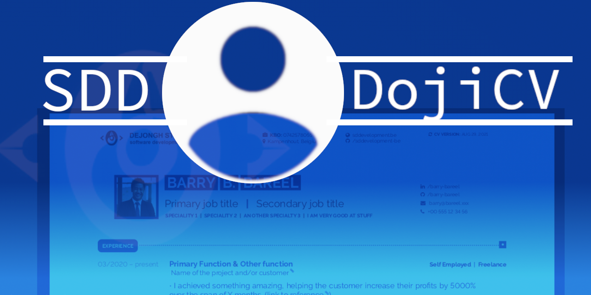

# DojiCV

A to-the-point [Typst](https://typst.app) template for resumés, aimed to help you write a visually pleasing CV.
Writing an engaging Resume is not an easy task. This template will help you by providing you with a basic structure in which to enter your personal information.

Examples can be found in the [examples directory](./examples).
People starting out their professional career will be most interested in the spacious [playful example](./examples/playful_example.pdf)
as it is meant to highlight your strengths and gives more focus to your educational achievements.


## Using this repository

### How it works

Typst is a markup-based typesetting system. You write your content in plain text files, and let Typst take care of the layouting.
This makes it easy to switch around your layout without touching the content of your files.

- You will need [Typst](https://github.com/typst/typst#installation), the [Raleway](https://fonts.google.com/specimen/Raleway) font and the [Font Awesome](https://fontawesome.com/download) desktop fonts.
- With [Nix](https://nixos.org) and [direnv](https://direnv.net), running `direnv allow` gives you all of the above (plus [just](https://github.com/casey/just)) automatically.
- Any editor will do. [Tinymist](https://github.com/Myriad-Dreamin/tinymist) adds Typst support to VS Code, Neovim and others, and the [Typst web app](https://typst.app) works too.

### Editing the template

In this repository, you will find the following files:

- **src/template/doji.typ:** The template that defines how your CV will end up looking: colors, sections, entries, skill ratings, ...
  Consider it the Typst equivalent of a CSS file in webdesign.
- **src/serious_example.typ / src/contractor_example.typ / src/playful_example.typ:** These files contain the content and structure of your resume.
  They use the functions defined in the template. Copy one of them and make your changes there.

### Building the CV

```sh
just build            # build all examples into examples/
just watch            # rebuild examples/serious_example.pdf on every change
just watch playful    # ... or any other example
```

Or call Typst directly:

```sh
typst compile src/serious_example.typ
typst compile --input gdpr=true src/serious_example.typ   # redacted version
```

Et voila, after some proofreading, your CV is ready to be sent out.

## Configuration options

All options are passed to the `cv` show rule at the top of your file:

```typ
#show: cv.with(theme: "blue", square: false, header: none)
```

- **The color of the CV:** `theme: "green"` or `theme: "blue"`, or pass your own dictionary with the same keys as `themes.green`.
- **Privacy toggle:** If you plan on publicly publishing your CV, it is wise to redact your contact information to avoid spam calls and mails.
  Compile with `--input gdpr=true` (or pass `gdpr: true`) to hide your email address, phone number and photo.
- **Corner style:** `square: true` for straight corners, rounded otherwise.
- **Company header:** `header: company-header(...)` shows your company information at the top of the first page.
  This can be useful for contractors, or for people applying for internal promotions. See the contractor example.
